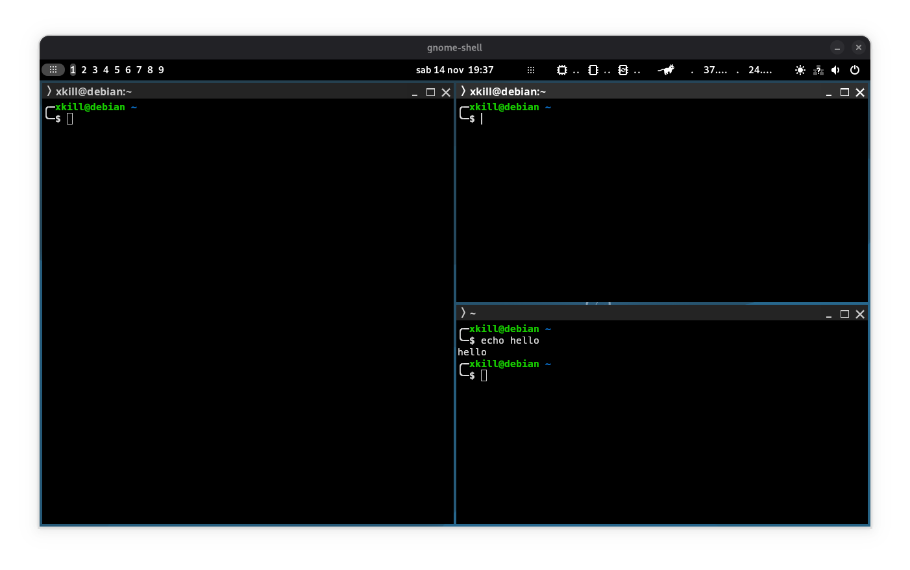

# Folletto

Fork di Mutter 48.7 + GNOME Shell 48.7 (Debian 13) con tiling in stile i3
integrato nel compositor. Due modalità commutabili **senza uscire dalla sessione**:
**normal** (GNOME come sempre) e **i3** (tiling).

I pacchetti Debian `mutter` / `gnome-shell` non vengono sostituiti: la build
vive in un prefix isolato (`/var/tmp/folletto/prefix` in sviluppo,
`/opt/folletto` nel pacchetto `.deb`).



## Funzionalità principali

- **GNOME invariato** — in modalità `normal` puoi usare GNOME come prima (finestre flottanti, overview, gesti).
- **Tiling** — in modalità i3 le nuove finestre si affiancano automaticamente (split orizzontale o verticale).
- **Griglia** — durante il drag delle finestre compare una griglia di celle dove rilasciare e affiancare.
- **Tabbed** — layout a schede: i titoli delle finestre in una riga, focus evidenziato.
- **Stacked** — layout impilato: i titoli uno sotto l’altro, sotto resta il contenuto della finestra attiva.
- **Niri mode** — strip orizzontale scrollabile: finestre affiancate a metà schermo, vista che si sposta con `scroll left|right`, swipe a tre dita o Super + rotella del mouse.
- **Sessione Wayland o Xorg** — al login GDM puoi scegliere **Folletto** (Wayland) o **Folletto on Xorg** (X11), senza toccare la sessione GNOME di sistema.
- **Gaps** — spaziatura interna (tra le celle) ed esterna (intorno al workspace), regolabile.
- **Personalizzazione** — modalità, layout predefinito, cornici e gaps dal pannello **Folletto** (Adwaita) o da GSettings (`org.folletto.wm`).
- **Keybinding** — scorciatoie in stile i3 (Super + …), modificabili da Impostazioni → Tastiera o dallo schema Folletto.

Toggle modalità: `Super+Shift+t`, oppure Quick Settings «i3 layout» in GNOME Shell Folletto.

## Build (isolata, niente `/usr`)

```sh
# 1. dipendenze di compilazione (chiede sudo; NON sostituisce GNOME)
./scripts/install-build-deps.sh

# 2. meson/ninja nel prefix isolato
./scripts/build.sh

# 3. prova nested (finestra, non sostituisce la sessione)
./scripts/run-nested.sh
```

## Pacchetto `.deb`

Dopo aver compilato il prefix (Mutter + GNOME Shell Folletto):

```sh
./scripts/build-deb.sh
sudo apt install ./dist/folletto-shell_*.deb
```

Il pacchetto `folletto-shell` installa:

- runtime in `/opt/folletto` (binari, librerie, schemi)
- `/usr/bin/folletto-gnome-shell` (avvia solo lo shell Folletto con le sue lib)
- wrapper `/usr/bin/folletto-session` e `/usr/bin/folletto-session-x11`
- voci di login **Folletto** (Wayland) e **Folletto on Xorg** (X11)
- sessione GNOME `folletto` (`org.folletto.Shell` + GSD), pannello Impostazioni e keybinding

Al login (GDM) scegli **Folletto** o **Folletto on Xorg**. La sessione usa
`gnome-session --builtin` così non parte lo `gnome-shell` di sistema; le
librerie Folletto restano isolate nel wrapper shell (evita freeze GDM /
schermo nero). La sessione GNOME di sistema resta disponibile come prima.

Se la sessione non parte: log in `~/.local/state/folletto/`.

Al **primo** avvio di una sessione Folletto le estensioni GNOME utente vengono
disabilitate (`disable-user-extensions`) per evitare conflitti con il tiling.
Se le riattivi (App Estensioni o Impostazioni), restano attive anche nei login
successivi: il marker è `~/.config/folletto/extensions-first-run-done`.

Smoke-test del solo packaging (senza compilare Mutter):

```sh
FOLLETTO_STUB=1 ./scripts/build-deb.sh
```

## Comandi i3 (C, in Mutter)

`Meta.Display.i3_command()` accetta la sintassi i3:

- `focus|move left|right|up|down`
- `split h|v|toggle`
- `layout grid|niri|splith|splitv|tabbed|stacked|toggle` — **grid** (default): split automatici sul focus; **niri**: strip orizzontale scrollabile, finestre a metà schermo
- `scroll left|right|delta N` — scorri la vista Niri (anche gesture: swipe 3 dita, Super+rotella)
- `floating toggle`
- `fullscreen`
- `kill`
- `workspace number N` / `move workspace number N`
- `resize grow|shrink width|height N ppt`
- `gaps inner|outer N`
- `move scratchpad` / `scratchpad show`
- `mode resize|default`
- `toggle_mode`

I keybind di default (solo in modalità i3, eccetto il toggle) seguono i3 con Super.

## Sicurezza host

- Build di sviluppo nel prefix isolato (default: `/var/tmp/folletto/prefix`)
- Pacchetto `.deb` in `/opt/folletto` + sessioni in `/usr/share/...`
- Sorgenti tipicamente sotto `/var/tmp/folletto/src/{mutter,gnome-shell}`
- Mai `meson install` in `/usr` e nessun replace dei pacchetti `mutter` / `gnome-shell`
